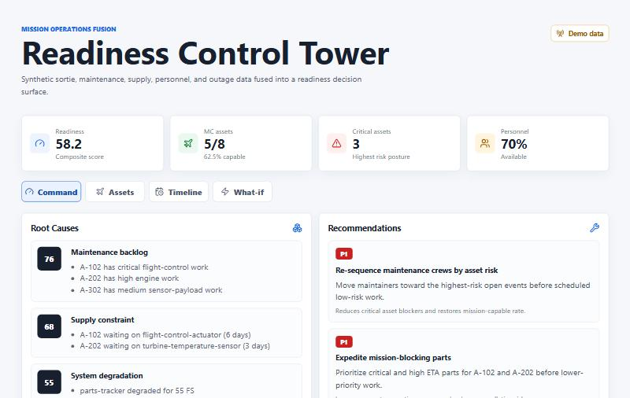
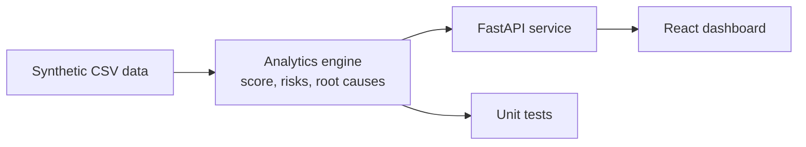

# Readiness Control Tower

[](https://github.com/WaffleBits/readiness-control-tower/actions/workflows/ci.yml)

A decision dashboard that explains why fleet readiness is degrading, not just that it
is, and estimates what a fix would change. It runs on synthetic sortie, maintenance,
parts, personnel and outage data.

**[Open the live demo](https://wafflebits.github.io/readiness-control-tower/)**



## Result

On the bundled data, the model scores readiness at 58.2, with 5 of 8 assets mission
capable, and ranks maintenance backlog, supply and system outages as the causes. The
what-if view projects the score change from an intervention such as expediting parts.
The demo runs entirely in the browser with bundled data. All of the data is synthetic.

## How it works



## Run it

```bash
docker compose up --build
curl http://localhost:8000/api/root-causes
python -m unittest discover -s backend/tests
```

The dashboard runs at `http://localhost:5173` and the API at `http://localhost:8000`.
To try a what-if from the command line:

```bash
curl -X POST http://localhost:8000/api/what-if \
  -H "Content-Type: application/json" \
  -d "{\"expedite_parts_days\": 2, \"restore_systems\": [\"maintenance-scheduler\"]}"
```

## Design decisions

1. **Standard-library analytics.** The scoring in `backend/app/analytics.py` has no
   service dependencies, so the model can be tested on its own.
2. **Explain before recommending.** Each root cause lists the assets and evidence
   behind it, because a score alone gives nobody anything to act on.
3. **Project a delta, not a schedule.** The what-if returns a projected change in
   readiness rather than pretending to optimize a full schedule.

## Limitations

- The data is synthetic, and scoring weights are illustrative rather than calibrated.
- It reads static CSV files. There is no live feed, auth or persistence.
- The what-if is a simple projection, not a simulation.

## More

- [Architecture](ARCHITECTURE.md)
- [Product requirements](PRD.md)
- [Roadmap](TODO.md)
